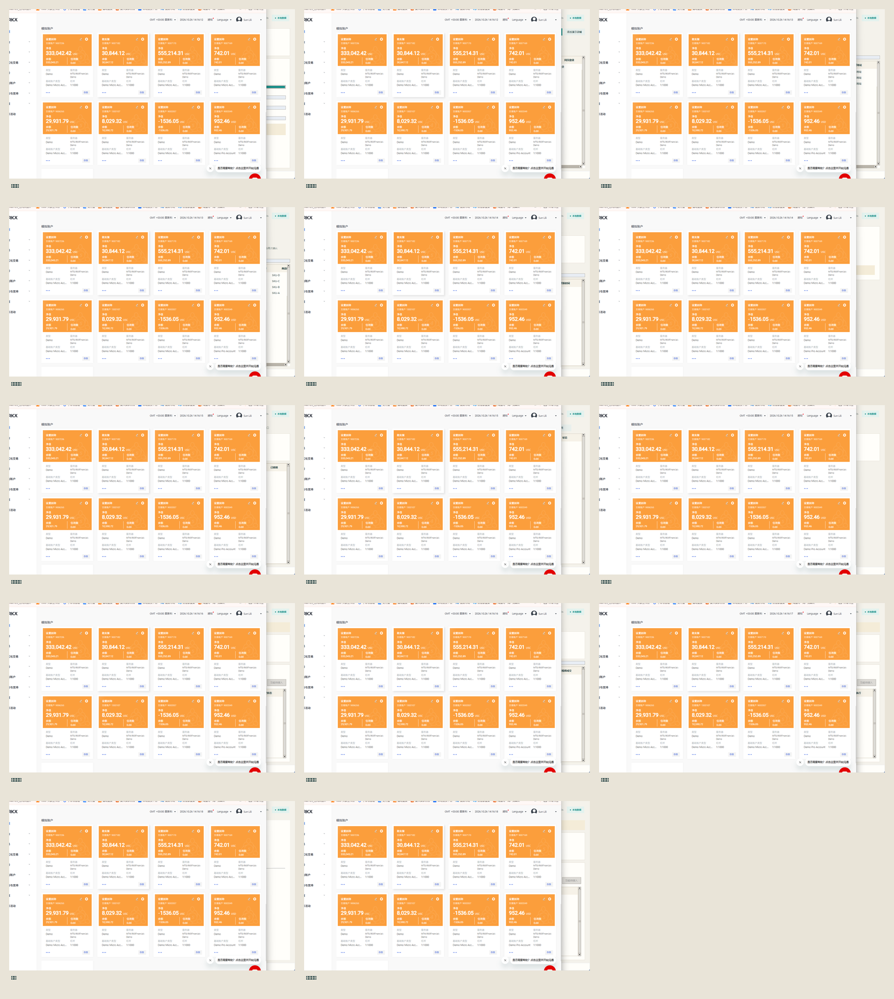

# 澜琅电商运营工作台

> 本源码快照基于重构 1.8.23。正式界面回滚为原有 Tk 布局；PySide6 仅作为后续等价迁移开发层。

## 界面框架预览



品牌色、图标规则和设计约束见 [品牌规范](assets/brand-guide.md)。

这是一个原创品牌界面、面向微信小店的多店铺桌面管理工具，当前重构版为
`重构1.8.23`（正式更新版）：

- 默认界面、登录、注册、页面布局和操作流程完全沿用 `1.6.63`
- 从 `1.6.63` 已验证业务主干分叉，保留接口、SQLite schema、账户目录和 DPAPI 数据兼容
- 使用 Python 3.11、隔离 PATH、PyInstaller 和现有自动更新流程重新构建
- 保留多页面后台任务、旧 Tk 界面和数据库隔离
- PySide6 作为后续新技术底座保留，但只有逐页视觉和功能对照通过后才切换正式入口

- 多店铺配置与 Windows DPAPI 加密密钥存储
- 支持 1000–5000 家店铺的批量导入、单事务保存和轮转检查
- 升级、重新解压和重启后从固定用户数据目录继续使用
- 每天自动备份数据库，保留最近 30 份
- 扫码登录直接通过 Cookie 校验店铺昵称与 `gh_` 账号标识，自动保存到实际扫码店铺
- 扫码成功后自动枚举同一微信可见的全部店铺，保存所有子账号登录态
- 同时存在主账号和子账号时跳过主账号，仅保留子账号
- GitHub Releases 自动检查、下载、校验、安装和重启
- 普通更新可关闭弹窗，重大故障版本使用不可关闭的强制更新
- 活动管理统一平台活动列表、单活动多店SKU预检和批量报名
- 平台活动支持店铺申报与活动商品价格提交两步执行
- 活动管理支持先同步所选店铺的平台商品，再执行活动预检
- 活动预览支持按SKU勾选、全选、清空和Excel导出
- 选择平台活动后自动加载商品预检，空表会显示操作提示
- 活动管理关键按钮拆分到独立操作栏，避免窗口宽度不足时被隐藏
- 活动目录基准店铺会持久保存，默认只显示当前可报名活动
- 活动商品使用平台批量请求格式，并按最多200个商品自动分批
- 活动申报、商品提交和优惠券操作支持永久执行记录
- 多店铺优惠券创建、停用、删除及来源模板批量匹配
- 限时限量购支持 168 小时、8.5 折和最低优惠规则校验
- 限时限量购续期支持刷新、多选、全选和逐店结果确认
- 限时活动按店铺合并为一场多商品活动，单场上限 200 个商品
- 限时商品预览支持每页 50、100、200、500 条的分页显示
- 官方稳定版 Access Token 获取和缓存
- 拉取最近 7 天订单列表及订单详情
- 本地 SQLite 订单、订单商品和商品缓存
- 按店铺、状态、日期、关键词查询
- 商品目录持久化、断点续拉和受控并发详情同步
- 商品批量上架、下架以及单 SKU 库存增加/减少
- 商品操作日志和失败项记录
- 订单备注、改价、改址申请和物流信息修改
- 售后同意、拒绝、协商、补寄、换货发货和物流更新
- 商品发布、编辑、撤回审核和删除
- 官方客服工作台入口
- 优惠券同步与状态查看
- 优惠券创建、修改和状态变更
- 商品主图/详情图上传、多规格 SKU 组合编辑
- 三页上货模板、标题/规格/图片过滤、阶梯价格、类目兜底和自定义属性
- 文件夹批量导入、任务日志和模板规则快照
- 数据大屏可见关闭按钮、定时刷新和按天经营明细
- 工作台、运营中心、采购中心、数据中心、自动化和账号中心框架
- 原创“澜琅”品牌标识及线性图标系统
- CSV / XLSX 导出
- 子账号只显示获授权页面，不显示团队管理和主账号数据工具
- 崩溃、线程异常、后台任务异常和界面卡顿自动诊断并上传
- 每日 09:30 自动巡检最近 24 小时诊断报告
- 自动更新下载支持断点续传、自动重试和 SHA256 二次校验
- 页面按需加载，减少启动时同时构造全部页面的开销
- 店铺刷新合并重绘，店铺指标使用短时缓存
- 店铺列表只读取界面需要的字段，避免读取加密 Cookie BLOB
- 正式账号优先联网验证，生产包默认不再包含测试账号
- 登录窗口可在未登录时直接检查、下载和安装更新

## 启动

```powershell
cd D:\GPT\langlang-1.7.0-pyside
uv venv --python 3.11 .venv
uv pip install --python .venv\Scripts\python.exe -r requirements_pyside.txt
.venv\Scripts\python.exe launcher.py
```

也可以双击 `run.bat`。正式界面保持原有 1.6.63 的登录页、主窗口、导航和
业务操作顺序；PySide6 页面保留为逐页等价迁移开发层。客户端连接配置从 `assets/auth_config.json`
或旧版安装目录的 `_internal/assets/auth_config.json` 读取；源码仓库不提交
真实客户端配置。

扫码登录使用本机 Microsoft Edge 的持久化登录会话。扫码成功后会读取完整 Cookie、自动关闭登录窗口，并按 Windows 用户加密保存。掉线后可在店铺页面重新扫码或导入 Cookie。

## 添加真实店铺

在应用左侧进入“店铺管理”，点击“添加店铺”，填写 AppID、AppSecret 和店铺名称。AppSecret 使用当前 Windows 用户的 DPAPI 加密后保存到本地数据库，不会写入日志。

微信接口通常要求调用机器的公网 IP 已加入开放平台白名单。遇到 `40164 invalid ip` 时，请先在微信小店后台配置白名单。

如果确实需要临时通过 `.env.local` 导入，该文件位于项目根目录。填好
`WECHAT_APPID`、`WECHAT_SECRET`、`WECHAT_STORE_NAME` 后运行：

```powershell
python -m weimi_manager.import_env
```

导入脚本不会回显 AppSecret。测试完成后应尽快在平台侧重置该密钥。

## 本地数据

源码运行时数据库位于项目 `data` 目录。免安装 EXE 使用当前 Windows
用户的固定数据目录：

```text
%LOCALAPPDATA%\LangLang\data\weimi_manager.db
```

首次运行新版 EXE 时，如果旧版解压目录内存在 `data\weimi_manager.db`，
软件会复制数据库、扫码登录浏览器缓存和网页会话到固定目录。旧文件不会被删除。
之后升级、重新解压或覆盖程序目录不会清空店铺、密钥、登录态和业务数据。

1.6.21 起会自动扫描同盘相邻旧版解压目录、下载目录、桌面和文档目录中的
旧版 `data\weimi_manager.db`。新数据目录没有店铺时自动恢复旧数据库；
已有店铺时绝不覆盖。

自动备份位于：

```text
%LOCALAPPDATA%\LangLang\data\backups
```

同一台电脑、同一个 Windows 用户下可以继续解密 AppSecret。换电脑或更换
Windows 用户时，DPAPI 不允许跨用户解密，需要重新保存 AppSecret 并扫码登录。

## 商品同步建议

商品目录和商品详情分开处理：

- `刷新目录`：只获取商品 ID，并保存分页游标。
- `同步待处理`：只拉取尚未同步或上次失败的商品详情。
- `一键同步`：目录未完成时先续拉目录，再处理待同步详情。

默认每批处理 300 个详情。全量店铺如果商品很多，可分批执行。中途关闭或点击停止后，下次会从持久化进度继续，不需要重新获取已完成的商品详情。

## 线上写操作

批量上架、批量下架和库存调整会直接调用微信官方接口。执行前界面会显示影响数量并再次确认，未确认时不会提交。微信上架接口还受提审额度、商品审核状态和风控限制，失败项会逐条记录。

## 重构1.8.23 验证边界

本地自动化、数据库兼容、页面构造、任务并发、打包、更新器和发行 ZIP
启动均已验证。以下项目仍必须在隔离的真实测试店铺环境中验收，不能仅凭
自动化测试标记为线上通过：

- 多店扫码、子账号识别、Cookie 导入/退出和会话失效恢复
- 商品七页签实时全量快照、复杂新增/编辑、类目与图片、批量写操作
- 订单敏感信息解密、改价、改址、物流修改和订单提取全流程
- 数据包真实上传、暂停恢复、类目审核、未知结果核实和远端落库
- 售后写操作、采购登录/同步、活动报名、优惠券、资金和店铺主页写操作
- 从真实 1.6.x 用户数据执行升级、自动更新替换与失败回滚
- Windows 10 干净机、8 小时稳定性、网络抖动和平台风控场景

未通过上述真实环境验收的能力不应视为生产完成项。详细边界见
[HANDOFF_1.8.23.md](HANDOFF_1.8.23.md) 和
[UI_PARITY_1.7.2.md](UI_PARITY_1.7.2.md)。

